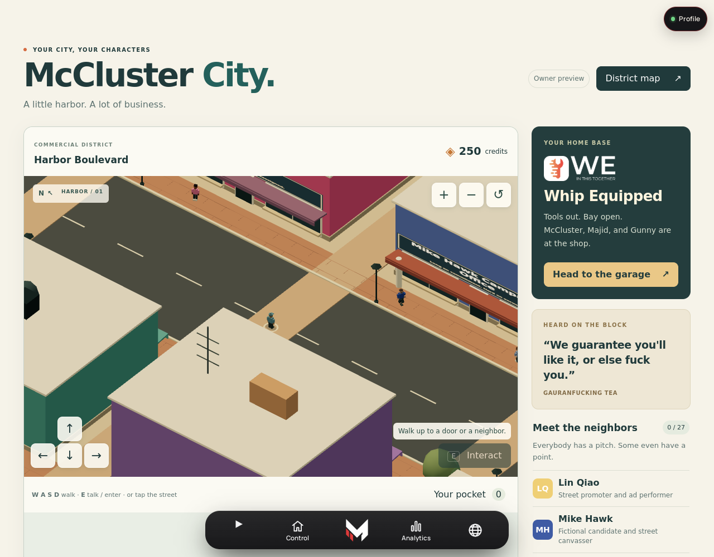
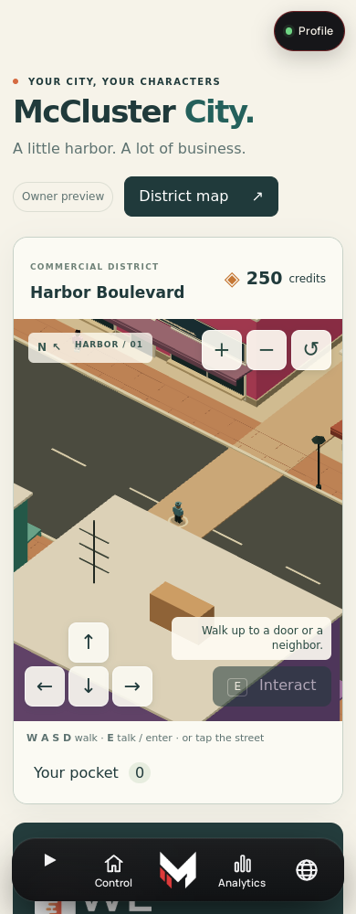
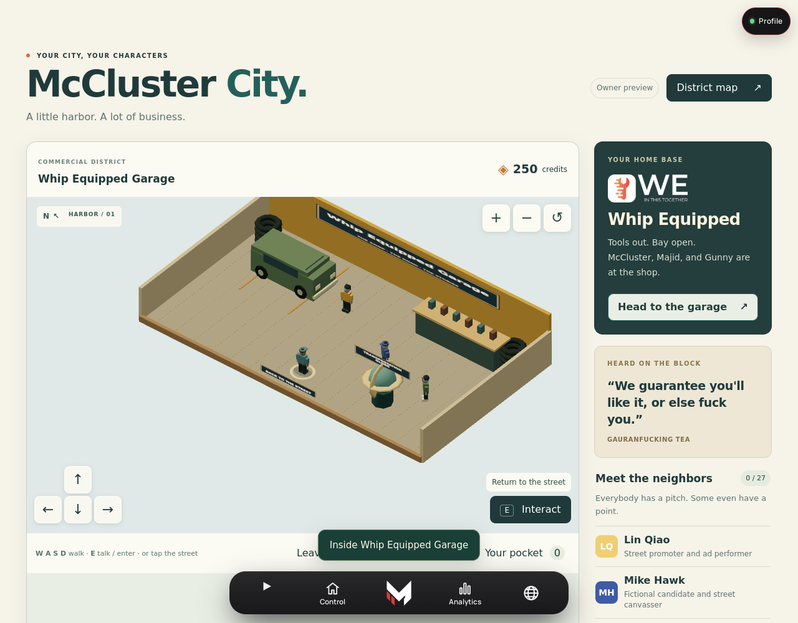
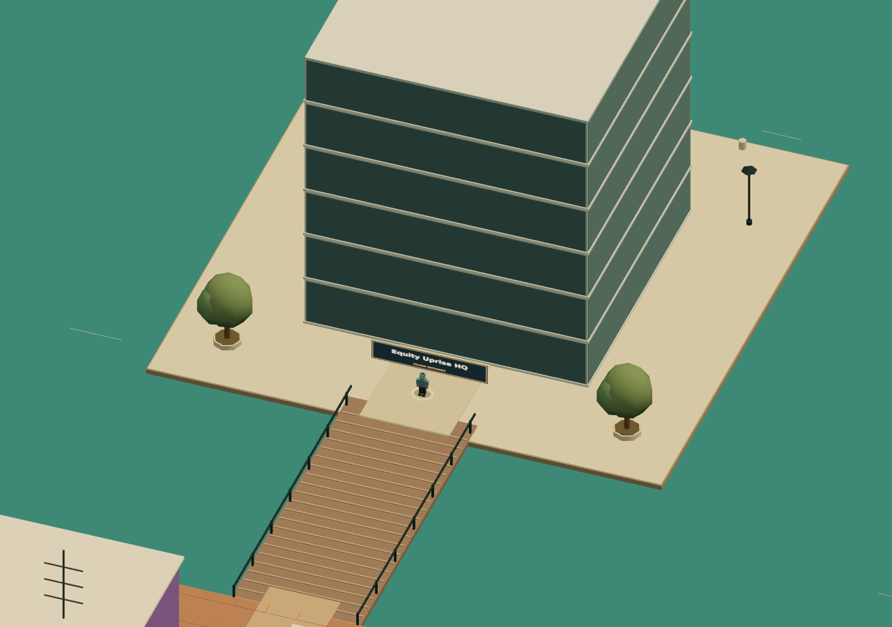

# McCluster City — first district verification

Date: 2026-11-03. Baseline: main `3cb77f056a75ed771f619a18f8bfbc242b3f087c`.
This records local source and browser verification. It is not evidence that a production account,
Worker release or OVH runtime has already accepted the new revision.

## Authored source

The canonical manifest is `core/data/fictional-city/district.v1.json`.

SHA-256: `7d2434d3ebf4c6b0d7d61710724945e00da76a73713cfbf58a801cf307f23ae9`.

It contains eight businesses, 24 new adult residents, three established garage characters,
24 collectible items and four existing destination routes. Each of the 27 people has three
six-line conversation topics: 81 topics and 486 authored exchanges, plus greetings and farewells.
`LORE.md` preserves all biographies and conversations. Newly authored material and recovered
owner concepts have separate provenance in the manifest.

The derived static district is byte-identical to the Core source. The separate story export has
13 complete screenplay entries, including the optional Jet Pass chapter. Before-song dialogue,
music-video treatment and after-song dialogue remain separate; Tears Won't Fall precedes Salvage
Title. Road Years recollections remain available at the same desk.

## Verification results

| Scope | Result |
| --- | --- |
| Root JavaScript suite | 1,461 passed, 0 failed, 3 existing skipped |
| Root Python suite | 7 passed |
| City state, manifest, collisions, Core client and publisher | 12 passed; included in root count |
| Additional scene spatial tests | 6 passed; included in root count |
| Core syntax and full Core suite | Passed; 428 tests passed |
| Signature, owner bridge and MCP continuity | 55 passed |
| Game Hub and owner-gate regression suite | 45 passed; included in root count |
| Full host browser walkthrough | 41 checks passed |
| Patch whitespace | `git diff --check` passed |

The browser walkthrough uses actual Three.js 0.180.0 and the authored data. Explicit local account
and API fixtures exercise owner, member and guest behavior; no production account is accessed.
Both 390px and 1280px widths have equal document scroll/client widths. Checks cover:

- Denial before template/game/data loading for members and guests.
- Exact-hash matching through the real Core reader and expected MCP response envelope.
- All 27 resident identities, nine enterable businesses including the garage, and geometry budget.
- Keyboard walking and actual Chromium touch events on the direction control; browser pinch zoom.
- Garage entry/exit, interior restoration after reload, and authored NPC topic rendering.
- Discovery, purchase deductions, inventory and receipt persistence, with no real checkout request.
- Complete story chapter access, existing HQ/globe destination links, and a delayed screenplay
  failure that cannot overwrite a newly opened resident conversation.
- No uncaught browser errors.

The separate scene exercise additionally covers bridge/island approach, water rejection, all
three garage crew, proximity interaction, camera occlusion and twelve interior rebuilds.

## Render measurements

Chromium 131.0.6778.0, headless SwiftShader software WebGL; device pixel ratio 1. The scene-only
measurements below use the canonical manifest. All staff bodies share three animated instance
batches, with per-person colour values.

| Viewport | Opening draw calls | Opening triangles | Tea draw calls | Garage draw calls | HQ draw calls |
| --- | ---: | ---: | ---: | ---: | ---: |
| 1280 × 900 | 73 | 24,026 | 22 | 29 | 60 |
| 390 × 844 | 55 | 23,034 | 21 | 27 | 56 |

These are measured scene counts, not a physical-device performance guarantee. Short software-rendered
samples varied; sustained phone/tablet FPS, thermal behavior and long-duration memory use remain
unmeasured. The scene caps rendering pixel ratio at 1.5 and disposes replaced interior resources.

## Screenshots

These are rendered captures, not concept art. The host screenshots show the owner fixture. The
island image is from the scene-only fixture and illustrates the simplified landmark, not the full
canonical architectural model. Viewport captures are used because this Chromium build's full-page
WebGL capture can leave offscreen compositor regions unpainted; actual scrolling was checked.

Machine-readable host results: [host-results.json](evidence/host-results.json).

## Release verification

Use the normal PR, exact-main CI, Pages and existing Worker release gates. Promote the same green
main SHA through `deploy/ovh-production`; require the observed Core `/health` deployment SHA to
match before describing the running server as current. An authenticated `game.lore.read` manifest
response must report the exact SHA-256 above before claiming the live browser-to-Core connection.
The browser retains the identical static fiction whenever the deployed Core version differs.

Current implementation limits: the connected situations are authored conversations, not persistent
multi-stage quests. Inventory does not equip clothing or spawn a functional purchased vehicle.
Driving, traffic, combat, recorded NPC performances and filmed song transitions are future work.
