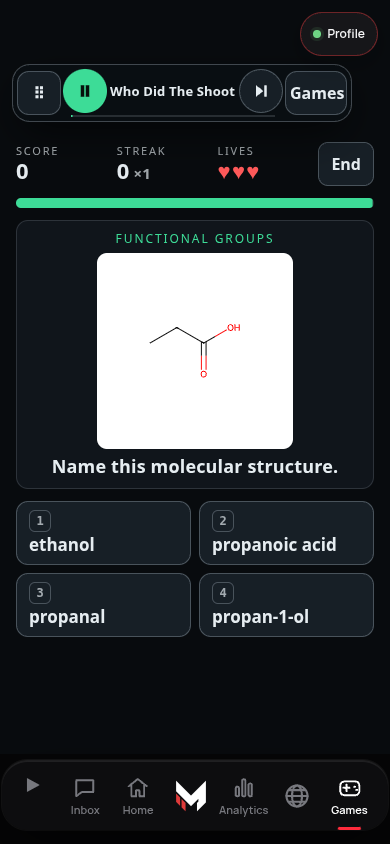

# Shared music across supported pages

The existing `MCC_MUSIC` engine stays in the document where playback began. Supported navigation retains that document and opens the destination in a same-origin frame. Listen, Game Hub, Control, PRIM3 Transit/course/World, City Arcade, Fictional City, Server Lab and the training terminal are explicit destinations. The existing Music → World continuity path is unchanged. Unsupported destinations leave the playing document normally.

The shared bottom bar and top-right Profile remain in the host. Game Hub keeps its own movable course selector and binds its music buttons to the retained engine. Other supported pages use the same `mountCapsule` movement/disclosure component with the current song, real play/pause/next, and a local action (library search, Control workspace focus, or return to Game Hub). Expanded/moved controls reserve space above the frame; they do not float over its answers. Position is a browser-local preference, not administrative policy. Keyboard arrows/Home and visible movement/reset controls complement touch/mouse drag.

`music-engine.js` exposes `bindSurface(document)` so Listen cards inside the exact active frame invoke the existing track resolver and reflect the current state. It does not construct a second music engine or copy signed audio URLs. Disposers remove listeners when a room unloads. The existing listen ledger, earned-play claims, preview limits and canonical access resolver remain authoritative. No timestamp-based restart stands in for continuity.

The host accepts transport attachment only from its exact current same-origin frame and explicit route allowlist. There is no cross-origin messaging API, credential transfer or entitlement cache. Each private destination executes its original owner/API checks. Returning to a retained owner page conceals it until a fresh owner check finishes; denial still revokes/reloads. Account changes retain the existing security behavior and may stop playback. Molecule Rush's clock does not run while its source document is retained out of view. This does not add a new assessment save format.

Navigation creates host history entries; frame navigation replaces its own entry. The source page ignores the shell's private fragment while retained. Back/Forward restores the correct room. Reloading the `#mcc_music_room=` address opens that room's canonical page normally; a reload cannot retain an audio element. Local Control/course routing remains inside the room. Source pages return without re-creating their transport.

A helper-load failure leaves music running with Retry. A room that fails its ready handshake offers Retry, Return to previous page and an explicit Open directly (stops music) escape. Existing owner-denied UI is a valid ready page, not a loading failure. No settings, server permissions, schemas or billing change.

## Verification and release

`node scripts/e2e/music-journeys.e2e.mjs` uses actual page, navigation, owner gate, music engine and shared capsule code. Only auth/API responses and valid WAV audio bytes are fixtures. Three.js 0.180.0 is served locally for the actual Transit renderer. The suite checks retained Audio identity and advancing time, both Games/Listen directions, Control and standalone destinations, browser history, visible Profile, study question retention, denied owner access, load recovery, Listen card controls and locked preview limits. Phone and landscape viewport evidence is captured in `/tmp/music-journeys-proof`.

Run the existing capsule and Music → World suites as regression checks, plus root tests. The Game Hub capsule workflow includes the new journey test and uploads screenshots. Fixture evidence does not establish real owner sign-in, provider audio availability, iOS media policy or physical-device behavior. Release coordination must review the exact head, merge serially, verify published artifacts, then perform authorized owner-device acceptance. No merge, deployment or production write is performed by these tests.

Integration overlaps: the release/customer stacks also touch shared `tabbar.js` and music code. Preserve their owner/consumer navigation and customer release behavior when reconciling. This change adds small transport/navigation hooks; it does not replace those stacks or change their auth implementation.

Local phone review image (synthetic owner and audio; not a live session):

## Retained-page integration review

Retained Control initializes its own normal `MCC_BAR` authorization API. Only its duplicate navigation presentation is hidden and made inert; Connected operations and News context still use the existing server-backed `admin()` / `verifyAdmin()` flow. Browser regressions exercise both private sections and withdraw them after a denied owner check. Short retained Control frames let the analytics deck flow vertically so the landscape viewport does not collapse its private read controls behind the globe.

The retained-room and World shells explicitly transfer visibility ownership. Before World opens, the room stops concealing siblings and hides its own frame/capsule. Returning directly to a room closes the World shell without adding an incidental history jump. Back/Forward recognizes World history before room history. The combined browser regression covers Music → Games/Control → World and both return paths, proving visible/non-inert surfaces and the unchanged playing Audio instance.
