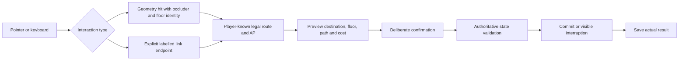

# Multi-floor interaction: evidence and acceptance contract

Reviewed 2026-11-04. This extends the [shared spatial proposal](SHARED-SPATIAL-CONTRACT.md). It is an implementation review, not a change of engine, building authority or geographic datum. Runtime remains pinned to Three.js 0.180.0; documentation research does not upgrade dependencies. City/Bridgeport implementation remains separately owned.

## Primary-source findings

Three.js raycasting sorts intersections by distance, supports explicit layers, and delegates intersection behavior to each object's raycast method. Mesh face orientation matters; back faces need an intentional policy. `setFromCamera` expects normalized coordinates for the active camera. These APIs identify geometry; they do not establish a legal game action. [Three.js Raycaster](https://threejs.org/docs/pages/Raycaster.html)

The Three.js picking manual converts client coordinates through the canvas rectangle before normalization and describes CPU raycasting limits around shader deformation and texture transparency. Picking must not assume that every visually transparent pixel corresponds to a geometric hole. [Three.js picking manual](https://threejs.org/manual/pages/picking.html)

Camera world and projection matrices are distinct. Picking and screen labels must use the same current camera and projection as rendering, including after an orthographic toggle, resize or camera move. That is a derived requirement for this product, rather than a guarantee supplied by a scene graph. [Three.js Camera](https://threejs.org/docs/pages/Camera.html)

Cesium's `drillPick` returns visually ordered objects, whereas `pickPosition` reconstructs a position from depth. Depth picking has a support flag; translucent-depth picking is separately enabled and adds rendering work. Perspective and orthographic depth reconstruction can differ. Consequently, a picked globe position cannot independently establish a tactical floor, route or collision result. [Cesium Scene picking](https://cesium.com/learn/cesiumjs/ref-doc/Scene.html#pickPosition), [drillPick](https://cesium.com/learn/cesiumjs/ref-doc/Scene.html#drillPick)

Godot models navigation links with start/end positions, directionality, enablement, navigation layers and traversal costs. This supports the design distinction between a valid connection and the geometry rendered between its endpoints. PRIM3 already has links; adopt the separation, not a second navigation framework. [NavigationLink3D](https://docs.godotengine.org/en/stable/classes/class_navigationlink3d.html)

Character movement and collision response are separate concerns from path selection. Godot's character-body guidance describes script-controlled movement with collision reporting; it does not imply that a successful path search moves a body safely through a doorway. For PRIM3, candidate edges still need swept-body clearance against shared metric solids before tactical/free-walk parity can be claimed. [Using CharacterBody2D/3D](https://docs.godotengine.org/en/stable/tutorials/physics/using_character_body_2d.html)

Pointer Events distinguishes pointer types, cancellation and capture. Touch may implicitly capture input, and capture is released after pointerup/cancel. A cancelled or multi-pointer gesture must not remain a pending move. Our deliberate mouse double-click is a page-level command policy; touch uses an explicit confirmation button. [W3C Pointer Events: capture](https://www.w3.org/TR/pointerevents3/#implicit-pointer-capture), [cancellation](https://www.w3.org/TR/pointerevents3/#the-pointercancel-event)

Unity explicitly documents that nearest NavMesh sampling ignores obstructions and can select the second floor from a point near a first-floor ceiling. Therefore nearest-point projection cannot repair an ambiguous PRIM3 floor hit: retain surface/floor identity and validate a connected route. [Unity NavMesh.SamplePosition](https://docs.unity.com/en-us/engine/6000.0/script-reference/unityengine/ai/navmesh/sampleposition)

## Reproduced failures and applied boundaries

1. **Legal upstairs, unpickable landing.** HQ links admit upstairs movement, but `level3d.tileAt` filters surfaces above the current cut. The rendered scene and navigation graph therefore expose different interaction sets. Reachable-floor buttons already exercise the real route. Sparse world-projected landing buttons extend that access into the scene; they carry exact legal endpoints and still invoke preview/Confirm. They do not enable arbitrary through-floor picking or alter geometry.
2. **Wrong floor fallback.** The old Transit click handler could replace an unreachable roof hit with ground coordinates. That fallback is removed: a destination retains its floor identity or is rejected.
3. **Preview moves the target.** With scroll anchoring enabled, a desktop target moved from visible y=37.86 to y=-9.14 after preview content changed. Page-local `overflow-anchor:none` fixes this; the browser regression asserts an unchanged projected position, not a retry until a click happens to work.
4. **Hidden information changes a preview.** A full-state exposure calculation revealed an unseen door's closure. Movement and exposure now use the same player-known projection. Execution retains full authoritative state and may stop at an unknown contact.
5. **Native double-click loses its target.** Courtyard's 2D redraw replaced tile DOM nodes during a click sequence. Locking an unchanged preview without rebuilding the board preserves native event identity. Mouse pairs are consumed once and cleared on cancellation, drag, leave and blur; touch never auto-confirms.
6. **Cell cost confused with physical distance.** HQ floor IDs are not metre heights; B1 uses engine ID8 while physically below ground. AP uses weighted resolver steps. The measured waypoint polyline uses declared surface heights and is labelled separately from a stair flight's real length.

7. **Reduced-motion active styling moves an input target.** The global reduced-motion `button:active` rule sets `transform:none!important`. It removed the landing button's centering transform during pointerdown, shifting the button by half its height; pointerup then hit the canvas. Independent CSS `translate` preserves positioning under that active rule. The regression uses actual native pointer events, never forced clicks.
8. **Picking before the next render can use stale matrices.** Both tactical renderers now update the camera world matrix immediately after placement, including the orthographic branch, before screen projection or ray construction. This enforces consistency when an input arrives between animation frames.

9. **Affordable endpoints overlap across floors.** On a phone, handles for several reachable upper floors projected over each other, hiding the nearest landing. Scene handles now show only legal endpoints of links connected directly to the selected floor. The full reachable-floor list remains available for longer routes; geometry and costs do not change.

## Invariants and regression matrix

| Invariant | Implemented check or remaining obligation |
| --- | --- |
| Selection, preview and confirmation name the same actor, destination floor and source state. | Movement guidance and lifecycle tests reject stale phase, AP, dead/downed/extracted actors and empty confirmation. |
| Every blue/orange destination is affordable under canonical rules; colors never create legality. | Guidance unit tests, exhaustive Courtyard resolver comparison, actual mouse/touch AP tests. |
| A first click, hover, pan, pinch or cancelled gesture spends no AP. | Courtyard and Transit browser checks; broaden real-device cancellation/capture tests before mobile certification. |
| The current camera, canvas rectangle and world point agree. | Orthographic/perspective, rotation, resize-width and fixed-hover checks; Cesium/Bridgeport integration remains separate. |
| Cutaway rendering cannot make a legal floor link inaccessible. | HQ movement-sheet regression; direct scene landing tests cover both staircases on390/1280. No arbitrary hidden-floor raycast override. |
| Confirmation spends AP once, and actor floor changes only after a legal commit. | Native double-click/touch confirmation plus upstairs route assertions. Camera cut may preview a floor without moving the actor. |
| Floor IDs, physical elevation and display coordinates remain distinct. | Display-frame unit tests and HQ/B1 physical-height tests. Save keys and geometry remain unchanged. |
| Known-state previews are identical when only hidden state changes. | Hidden-unit, unseen-door, last-seen-door and exposure tests; real execution interruption tested separately. |
| A renderer failure cannot silently skip enemy opposition or erase recovery. | Atomic lifecycle and renderer-failure browser scenarios. |
| Render, collision, navigation and LOS reference one metric source. | Not yet satisfied across city/HQ modes. The diagnostic records3 blocked door anchors and48 directed clearance discrepancies in the existing export adapter. |
| A topology switch preserves measured geometry and declares changed rules. | Proposal only. Square remains supported; no cosmetic hex selector is presented as navigation. |
| Accessible controls stay usable when a scene target is hidden, off-screen or too small. | Landing movement-sheet alternative and labelled DOM buttons; phone-width/overflow checks. Physical phones and assistive-technology testing remain outstanding. |

## Command boundary

The geometry-hit branch must not silently become a link control or another floor. Conversely, a labelled link control is an explicit destination request, not evidence that an occluded floor mesh was selected. Browser tests verify both the DOM hit target and the exact destination shown before confirmation.

## Implementation sequence beyond the patch

First retain stable semantic hit results: object/link ID, surface/floor ID, metric point, frame revision and interaction type. Visual closest-hit order selects candidates; game rules approve the command. Keep explicit interaction layers for navigation handles, operatives and environment, with deterministic overlap precedence and no hidden-information leaks. A ceiling cut changes visibility, not the floor graph. Geometry picking must consider foreground occluders before accepting a destination; explicit labelled landing controls are navigation handles, not a claim that an occluded mesh was hit. Retain the movement-sheet alternative when a handle is off-screen or obscured.

Next compile render meshes, collision solids, navigation surfaces/links and LOS blockers from the same versioned metric authority. Verify approach, passage and exit clearance for each door/stair/furniture fixture, in both directions, using the same actor dimensions. Continuous movement must sweep the body along a path; testing only its destination or snapping a door to a cell centre is insufficient. Unsupported or ambiguous geometry should refuse traversal with a diagnosable object ID.

Then version topology, geometry and source provenance in new saves while retaining old payloads and readers. Test square and hex adapters against the same narrow-door, corner, stair, furniture and objective fixtures before exposing a playable switch. Neither a new camera projection nor a denser guide grid is a migration.

Finally extend the browser matrix to device-pixel ratios, camera motion during pointerdown/up, resize/orientation changes, overlapping controls, pointercancel/lost capture, touch plus mouse compatibility events, narrow/off-screen landing markers, keyboard focus and reduced motion. Add actual-device testing separately. These are concrete acceptance obligations, not claims that the current browser suite covers every input platform.
