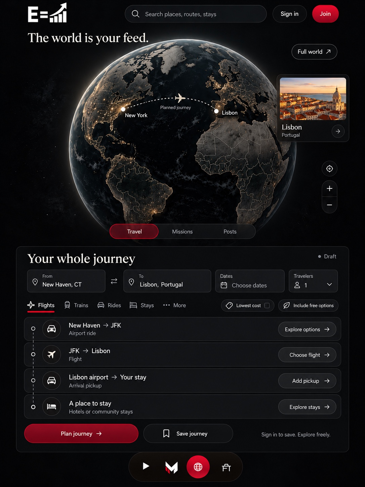

# Travel is the public front door

Owner decision, October 17, 2026: **travel is the basis of the logged-out
World homepage.** The owner re-supplied the earlier reference below and explicitly
identified it as the actual standard: cleaner, more premium, and travel first.
This is the controlling public-entry direction, not another optional visual idea.

The reference is preserved byte-for-byte from
`899F1722-8390-4B63-9F59-772C4813B937(1).jpeg`.

## What the visitor sees

1. The supplied white Equity Uprise emblem, destination search, and Sign in / Join.
   The headline is **“The world is your feed.”** Use the reference's restrained
   editorial serif for the headline and journey heading, with clean sans-serif
   controls and generous spacing.
2. A large, cinematic Earth on black: subdued land, fine geographic boundaries,
   warm city lights, a soft atmospheric edge, and very little interface over it.
   Retain direct globe interaction, Full world, location and zoom controls.
3. **Travel · Missions · Posts**, with **Travel selected by default for guests**.
   These are local World modes. They do not replace the shared bottom bar.
4. **“Your whole journey”**: From, To, Dates and Travelers; flights, trains,
   rides and stays, with additional travel modes available in context. Lowest-cost
   and free options belong to the journey experience when backed by usable data.
5. An ordered itinerary spanning the whole trip: getting to departure, the
   long-distance leg, arrival transport and somewhere to stay. Keep planning,
   requested and confirmed states distinct. Use contextual actions for each leg.
6. A destination card and an understandable planned connection on the globe,
   linked to the visitor's chosen destination and actual draft. New Haven,
   New York and Lisbon in the reference illustrate a journey; they are not a
   known visitor location, a mandatory route or a confirmed reservation.
7. Free guest discovery and planning. Signing in adds the member capabilities,
   including saved journeys when persistence is implemented. Account/profile
   stays at the top right. The existing shared bottom navigation stays available.

## Visual and interaction rules

- Follow the reference's black, charcoal, off-white and restrained crimson palette.
  The globe is the visual focus; the planner is the primary useful surface.
- Keep the whole trip coherent rather than presenting unrelated booking widgets.
  On phones, give the globe room and make journey details easy to reach and use.
  Preserve the preference for a persistent globe with independently navigable
  detail content; adapt the tall reference to the available viewport rather than
  shrinking every control to force the complete image onto one phone screen.
- Travel, Missions and Posts stay discoverable. Opening the site should not
  require scrolling through a mission/community feed to discover travel.
- Use the actual supplied logo assets, proportionally scaled and uncropped.
  Do not extract or redraw the emblem, M, or other artwork from this mockup.
- The reference's bottom dock illustrates placement and tone. Existing shared
  destinations and their supplied artwork remain authoritative; this correction
  does not add an unexplained fourth global tab.
- Phone first: readable type, 44px interaction targets, keyboard/focus support,
  reduced motion, no horizontal document overflow, and usable planning without WebGL.

## Product boundaries that still apply

- This is the **public World entry** served by `mnet.html` at `mccluster.org/`
  through the canonical Worker. Matthew's personal homepage and album remain
  separate; their identity is not replaced by a travel portal.
- Admin analytics continues to prioritize unique visitors and the geographic
  heat map. The public globe presents travel discovery and a chosen journey.
- Flight/satellite telemetry, CCTV, vehicle telemetry and Hitman's Halo feeds
  remain internal operator tools. Travel planning does not expose those feeds.
- Missions require an application and approval, with the separately specified
  introduction video, motivation, résumé and onboarding requirements. Creating
  an account does not make someone an approved mission participant.
- Use the canonical McCluster auth, APIs and database. Do not invent fares,
  available seats, free rides, community stays, reservations or dispatch status
  to make the screenshot look populated. A pictured capability is a product
  requirement, not evidence that its backend is operational.

## Repository baseline at this decision

Reviewed `main` at `37ce058c721e672c59da37912315f1c3d68d8308`.

| Area | Verified repository state | Required direction |
| --- | --- | --- |
| Public shell | `mnet.html` opens a globe with mission/community content; the local feed filters are For you / Community | Guest entry opens Travel, with Missions and Posts beside it |
| Globe | Existing Cesium scene, country selection, location/zoom, full-world view and same-origin messaging | Reuse the renderer and interactions; match this reference's travel presentation |
| Travel core | `js/travel/navigation-core.mjs` builds immutable draft itineraries and explicit Google/Apple directions links | Connect a coherent journey interface to this existing foundation |
| Existing transport sheet | `js/world-transport.js` offers external ground directions | Reuse the working handoff without treating a flight as a driving route |
| Travel Desk | `travel-desk.html` and `workers/travel-quote.js` contain a separate owner workflow | Audit deployment, authorization and provider readiness before any public integration |
| Whole-journey screen | No public Travel / Missions / Posts planner wired into this reviewed main tree | Implement and verify against this reference rather than calling the navigation primitives a finished travel product |

Earlier conversational reports described additional journey work, but that
integration was not found in this reviewed main tree or the travel/journey branch
search. Recover any such implementation before duplicating it; do not claim it
is shipped solely from an earlier progress message.

## Relationship to older direction

This owner correction supersedes the **logged-out default and visual standard**
in `../action-network/EDITORIAL-WORLD-REFERENCE-20261016.md` where it led with
missions/community or hid the supplied emblem. That document remains useful for
existing social behavior, navigation, authorization and prior verification.
The architectural and internal-intelligence boundaries remain in force.

This change records the approved standard and current implementation gap.
It does not itself change the deployed homepage or claim a completed booking system.
